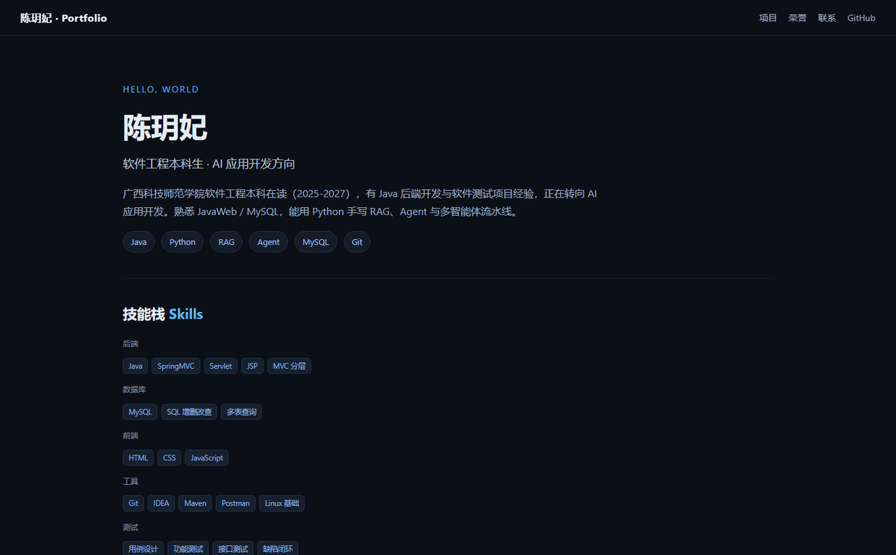
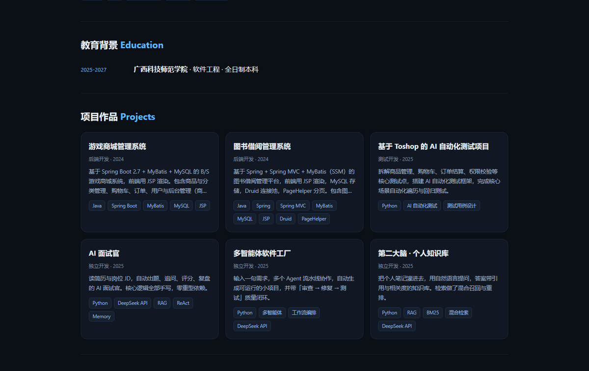

# 🌐 个人博客 / 作品集

> **在线访问：** https://jiangchenmoonchoi0908.dpdns.org/

一个用 Python 标准库手写的个人作品集：**前台展示 + 后台管理**。个人信息、项目、奖项都能在线增删改，项目还能上传自己的代码文件并在线预览。





---

## ✨ 功能

**前台（作品集）**
- 个人信息、联系方式、技能栈、教育背景
- 项目卡片 → 详情弹窗（技术要点、项目成果、运行截图）
- 个人荣誉

**后台（`/admin`，动态版）**
- 基本信息编辑（姓名、简介、联系方式、教育、技能）
- 项目增删改（名称、角色、时间、技术栈、简介、亮点、成果）
- 奖项增删改
- 上传代码文件（支持多文件）、在线预览、下载、删除

> 线上部署的是**静态版**：数据内联在 HTML 里，不依赖后端，打开即用；仓库同时保留动态版源码，本地运行可体验 `/admin` 后台。

---

## 🚀 本地运行

```bash
python app.py
```

- 作品集：http://127.0.0.1:8003
- 管理后台：http://127.0.0.1:8003/admin

---

## 📁 目录结构

```
personal-blog-portfolio/
├── app.py                # 动态版：Web 服务 + REST API
├── core/
│   ├── config.py         # 端口、上传限制、可预览类型
│   └── store.py          # JSON 存储 + 文件管理（路径穿越防护）
├── data/
│   ├── site.json         # 个人资料 / 项目 / 奖项
│   └── projects/<id>/    # 项目代码文件与运行截图
├── static/
│   ├── index.html        # 作品集前台（静态版，数据内联）
│   ├── admin.html        # 管理后台
│   └── demo.html         # 演示页
├── docs/                 # README 截图
└── requirements.txt
```

---

## 🔌 API 一览（动态版）

| 方法 | 路径 | 说明 |
|---|---|---|
| GET | `/api/site` | 获取全部数据 |
| PUT | `/api/profile` | 保存个人信息 |
| POST | `/api/awards` | 新建奖项 |
| PUT / DELETE | `/api/awards/<id>` | 修改 / 删除奖项 |
| POST | `/api/projects` | 新建项目 |
| PUT / DELETE | `/api/projects/<id>` | 修改 / 删除项目 |
| POST | `/api/projects/<id>/files` | 上传文件（`{name, content}`，content 为 base64） |
| DELETE | `/api/projects/<id>/files/<name>` | 删除文件 |
| GET | `/api/projects/<id>/files/<name>` | 下载文件；加 `?preview=1` 在线预览 |

---

## 🎯 面试时怎么讲

> "我用 Python 标准库手写了一个作品集网站：前台展示项目，后台可以实时改内容、上传代码文件。"

**讲设计**：
> "前后端分离，数据放 JSON，写操作加锁；上传的文件做路径穿越防护和白名单，代码文件可以在线预览。"

**讲取舍**：
> "没用框架，是因为想展示我能从零搭 REST 接口和前端；实际生产我会换 FastAPI + 数据库 + 鉴权。"

**加分点**：现场打开 `/admin` 改一个奖项，前台立刻刷新——内容是可维护的，不是写死的静态页。

---

## 🔧 可以继续扩展

- 后台加登录鉴权（当前无密码，仅适合本机演示）
- 项目详情支持 Markdown 正文
- 用 SQLite 替换 JSON，支持多用户
- 自定义域名 + 访问统计
